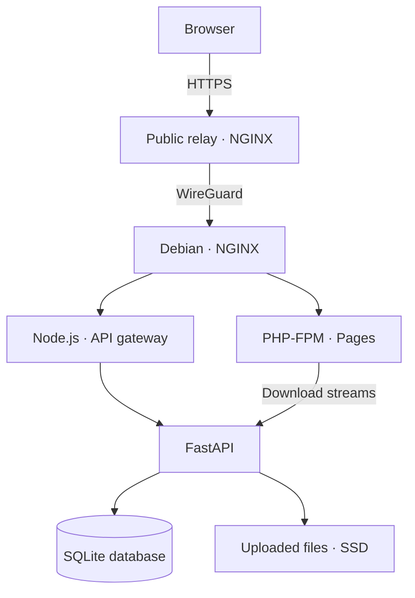

<div align="center">

# 📂 Filevoya

### Simple file sharing. Your storage. Your infrastructure.

Upload files and folders, share an expiring link, and manage your transfers from one dashboard.

[](https://filevoya.site)
[](#-architecture)
[](#-deployment)


</div>

---

## ✨ Overview

Filevoya is a self-hosted file transfer website built with PHP, TypeScript, Bootstrap, a Node.js gateway, FastAPI, and SQLite. Uploaded content stays on the storage you control.

The frontend uses core PHP and TypeScript without Vite. Docker Compose runs the application services, and a public reverse proxy can connect privately to the storage server through WireGuard.

## 🚀 Features

| Feature | Description |
| --- | --- |
| 📤 File and folder uploads | Select files or a folder through the Upload menu, or use drag and drop. |
| 🗂️ Folder structure | Preserve relative file paths when uploading folders and downloading ZIP archives. |
| 🔗 Share links | Share a transfer through its download page. |
| ⏳ Expiration | Transfers expire after 24 hours in the current deployment. |
| ♻️ Automatic cleanup | Expired transfers and pending uploads inactive for 15 minutes are removed by the cleanup task. |
| 📊 Storage allowance | Accounts and guest identities have a 5 GB total storage allowance in the current deployment. |
| 👤 Accounts | Register, sign in, sign out, and update your password through Settings. |
| 📁 Your files | View account transfers, upload progress, storage usage, and share links. |
| 🗑️ Transfer deletion | Account owners can delete their transfers and release their reserved storage. |
| 🔄 Resumable chunks | Retry interrupted uploads while the upload page and selected files remain available. |
| 📥 Download options | Download individual files directly or download a transfer as a ZIP archive. |
| 🛡️ Pending upload limits | Limit outstanding reservations per client IP, even when a new guest cookie is created. |

> Direct folder downloads depend on browser support. ZIP archives provide a portable way to download a folder with its file structure intact.

## ⚙️ Current limits

| Setting | Default |
| --- | --- |
| Storage per account or guest browser identity | 5 GB |
| Maximum transfer size | 5 GB |
| Files per transfer | 25 |
| Transfer lifetime | 24 hours |
| Upload chunk size | 8 MiB |
| Pending transfers per client IP | 3, totaling at most 5 GB |
| Pending upload inactivity timeout | 15 minutes since creation or the last successful chunk |
| Transfer creation attempts per client IP | 10 per minute |
| Browser timeout for each upload chunk | 120 seconds |

Guest storage is associated with a browser cookie. Pending-upload and client request limits use the client IP, so people sharing a public IP share those limits. Completed transfers remain subject to the account or guest storage allowance and their normal expiration.

## 🧰 Technology stack

| Layer | Technology | Purpose |
| --- | --- | --- |
| Pages | PHP | Render the website and account pages. |
| Browser logic | TypeScript | Handle uploads, drag and drop, progress, and account interactions. |
| Interface | Bootstrap + CSS | Provide layout, menus, forms, and styling. |
| API gateway | Node.js + TypeScript | Validate and forward browser API requests. |
| Application API | FastAPI + Python | Manage authentication, transfers, upload chunks, downloads, and cleanup. |
| Database | SQLite | Store accounts, sessions, transfer metadata, ownership, and upload progress. |
| Application web server | NGINX + PHP-FPM | Serve assets and PHP pages, and proxy API requests. |
| Containers | Docker Compose | Run the `web`, `php`, `gateway`, and `api` services. |
| Host | Debian Linux | Run the application and its persistent storage. |
| Private relay connection | WireGuard | Encrypt traffic between the public relay and the storage server. |

## 🏗️ Architecture

The deployed layout uses an AWS relay for public HTTPS traffic and a Debian server for the application, database, and uploaded files.



The relay forwards requests to the application. Uploaded files are stored on the Debian server rather than retained as a separate copy on the relay. The application remains behind the relay; home router port forwarding is not required for this layout.

## 🔐 Security and encryption

- **HTTPS:** The public relay terminates TLS using a Let's Encrypt certificate.
- **Private transport:** WireGuard encrypts relay-to-server traffic.
- **Storage encryption:** The deployed Debian data partition uses LUKS2 with AES-XTS; swap is also encrypted.
- **Account sessions:** Session cookies use `HttpOnly`, `SameSite`, and the `Secure` flag in the HTTPS deployment.
- **Request validation:** Upload requests have size limits, validated offsets, and upload-token checks.
- **Storage paths:** File access validates relative paths and protects against symlink traversal.
- **Ownership:** Account transfer deletion requires the authenticated owner.
- **Abuse controls:** Authentication and transfer creation use per-client request limits. Pending upload counts and reserved bytes are checked within SQLite write transactions; abandoned uploads expire automatically.
- **Trusted client addresses:** The application web server accepts the original client address only from the configured relay, and the API trusts only configured internal proxy networks.
- **Session recovery:** Invalid or revoked account cookies are cleared so guest uploads remain usable; account-only endpoints still require authentication.

Storage encryption and the relay configuration are deployment choices, not settings automatically enabled by building the containers. Filevoya does **not currently provide browser-side end-to-end encryption**: the application server can access uploaded content while its storage is unlocked. A public relay also does not eliminate application attacks or the bandwidth used by legitimate transfers.

## 📂 Project layout

The repository root contains this README and the license. Application paths in the table below are relative to the inner `transfer-serv/` directory.

| Path | Contents |
| --- | --- |
| `api/app/` | FastAPI application, authentication, transfer handling, storage, downloads, and cleanup. |
| `api/Dockerfile` | Python API image and Uvicorn startup command. |
| `frontend/src/` | TypeScript sources for browser interactions. |
| `frontend/public/` | PHP pages, public assets, and generated JavaScript. |
| `frontend/includes/` | Shared PHP page components. |
| `frontend/Dockerfile` | Frontend container build configuration. |
| `gateway/src/server.ts` | Node.js API gateway. |
| `gateway/Dockerfile` | Gateway image build configuration. |
| `nginx/default.conf` | Application NGINX configuration. |
| `scripts/clone-bootstrap.mjs` | Bootstrap asset-copying script. |
| `compose.yaml` | Application services, networks, ports, and persistent mounts. |

## 💻 Quick start

### Prerequisites

- Linux for the included development launcher.
- Git to clone the repository.
- Node.js 24 or newer, with npm.
- Python 3.12 or newer, with `pip` and virtual-environment support.
- PHP 8.2 or newer, available as `php` on your command line.
- Available local ports: `8000`, `3000`, `8001`, and `8080`.

Docker is required for the container deployment described below; it is not required for this local development launcher.

### Clone and enter the application directory

```bash
git clone https://github.com/qy0m/filevoya.git
cd filevoya/transfer-serv
```

The outer `filevoya` directory is the repository folder. You can give it any name when cloning:

```bash
git clone https://github.com/qy0m/filevoya.git my-project
cd my-project/transfer-serv
```

Use one of those clone examples. The inner `transfer-serv` directory contains `package.json` and `compose.yaml`. **Run the setup, check, and Docker commands in this README from that application directory.** If you rename or move it, enter the directory containing those two files instead.

### Install and run locally

```bash
python3 -m venv .venv
.venv/bin/python -m pip install -r api/requirements.txt
npm ci
mkdir -p var/database var/uploads
npm run dev
```

Open [http://127.0.0.1:8080](http://127.0.0.1:8080). The launcher builds the assets, starts the API, gateway, and PHP development server, and checks that the services are ready. Press **Ctrl+C** to stop them.

Local development uses a local database and upload directory under `var/`. It uses HTTP and disables Secure cookies for localhost. It does not require AWS, WireGuard, or the production storage mounts.

## 🐳 Deployment

### Requirements

- Docker Engine and the Docker Compose plugin.
- Persistent database and upload directories with permissions matching the API container user.
- Environment configuration appropriate to the deployment.
- For the public relay layout: a domain, HTTPS reverse proxy, and working WireGuard connection.

### Configure the application

From the application directory (`transfer-serv/` in this repository), create a local `.env` file using your editor if one does not already exist. Environment files are excluded from the distributed source archive.

Review `.env` and the bind mounts in `compose.yaml` before starting the containers. Do not overwrite an existing deployment's `.env`.

| Setting | Purpose |
| --- | --- |
| `APP_ORIGIN` | Exact browser-facing origin, including the scheme and any non-default port. |
| `COOKIE_SECURE` | Enable secure session cookies for HTTPS; ensure Compose passes this setting to the API. |
| `HTTP_BIND` | Host address used by the application web port mapping. |
| `HTTP_PORT` | Published application web port. |
| `TRUSTED_PROXY_NETWORKS` | Comma-separated internal proxy CIDRs; match the actual Docker network and keep API/gateway ports unpublished. |
| `DATABASE_PATH` | Database location inside the API process environment. |
| `UPLOAD_PATH` | Upload directory inside the API process environment. |

The container paths must correspond to the persistent mounts in Compose. Host storage locations and container storage locations may differ. The included Compose file also binds the web service to `10.77.0.2`; adjust that mapping if your WireGuard address differs.

### Build and start

Mount and unlock any required encrypted storage before starting the application. If Compose binds a web port to a WireGuard address, bring up that interface first.

```bash
sudo docker compose config --quiet
sudo docker compose build
sudo docker compose up -d --wait --wait-timeout 120
sudo docker compose ps
```

Check the public deployment:

```bash
curl --fail-with-body --max-time 20 \
  https://filevoya.site/api/health
```

For another deployment, replace the URL with its own origin. A successful response includes:

```json
{
  "ok": true,
  "gateway": "node-typescript",
  "api": "fastapi",
  "database": "sqlite3"
}
```

### Development checks

From the application directory, with the project dependencies installed:

```bash
npm ci
npm run check
npm run build
.venv/bin/python -m compileall -q api/app
```

The build compiles frontend and gateway TypeScript and copies Bootstrap assets. Generated frontend JavaScript is written to `frontend/public/assets/js/`. Generated assets are excluded from the source archive and rebuilt during the Docker build to keep them consistent with the TypeScript source. The gateway uses bounded buffering for upload chunks.

### Logs and updates

```bash
sudo docker compose logs --no-color --tail=100 api gateway web
```

From the application directory, rebuild and deploy affected services after updating source files. For example:

```bash
sudo docker compose build api gateway web &&
sudo docker compose up -d --wait --wait-timeout 120
```

## 💾 Storage and backups

The deployed storage layout uses these host directories:

| Directory | Purpose |
| --- | --- |
| `/srv/transfers/database/` | Persistent SQLite database. |
| `/srv/transfers/uploads/` | Uploaded file contents. |
| `/srv/transfers/backups/` | Database and configuration backups. |

Back up a live SQLite database using SQLite's backup API rather than copying only its main file during active writes. The deployed backup process verifies database integrity and configuration archives. Keep an off-device recovery copy and, when using LUKS, a protected header backup.

Database and configuration backups do not automatically include uploaded file contents. Include those separately if your recovery requirements call for restoring active transfers.

## 🧪 Functional checks

- [ ] Public health endpoint responds successfully.
- [ ] Account registration, login, logout, and Settings work.
- [ ] Guest and account storage allowances are enforced.
- [ ] File selection, folder selection, and drag and drop work.
- [ ] Interrupted uploads can resume while the upload page remains open.
- [ ] Downloaded files retain their names and contents.
- [ ] ZIP downloads preserve folder paths.
- [ ] Deleting a transfer releases storage and invalidates its share link.
- [ ] Expired transfers and inactive pending uploads are cleaned up.
- [ ] Replacing a guest cookie does not bypass pending-upload limits for the same client IP.
- [ ] An invalid account session is cleared and guest uploads remain available.
- [ ] One client's login throttle does not block a different client IP.
- [ ] The application recovers after its required storage and network interfaces are available following a reboot.

## 🛠️ Contributing

Describe the problem or proposed feature in an issue before making a substantial change. Keep changes focused, run the relevant checks, and include clear reproduction steps for fixes.

Never commit `.env` files, SSH keys, WireGuard private keys, TLS private keys, account databases, uploaded content, or recovery archives. Keep obsolete source backups such as `database.py.bak` out of the repository and build context.

---

<div align="center">

**Filevoya — file sharing on infrastructure you control.**

[Visit Filevoya](https://filevoya.site) · [Back to top](#-filevoya)

</div>
