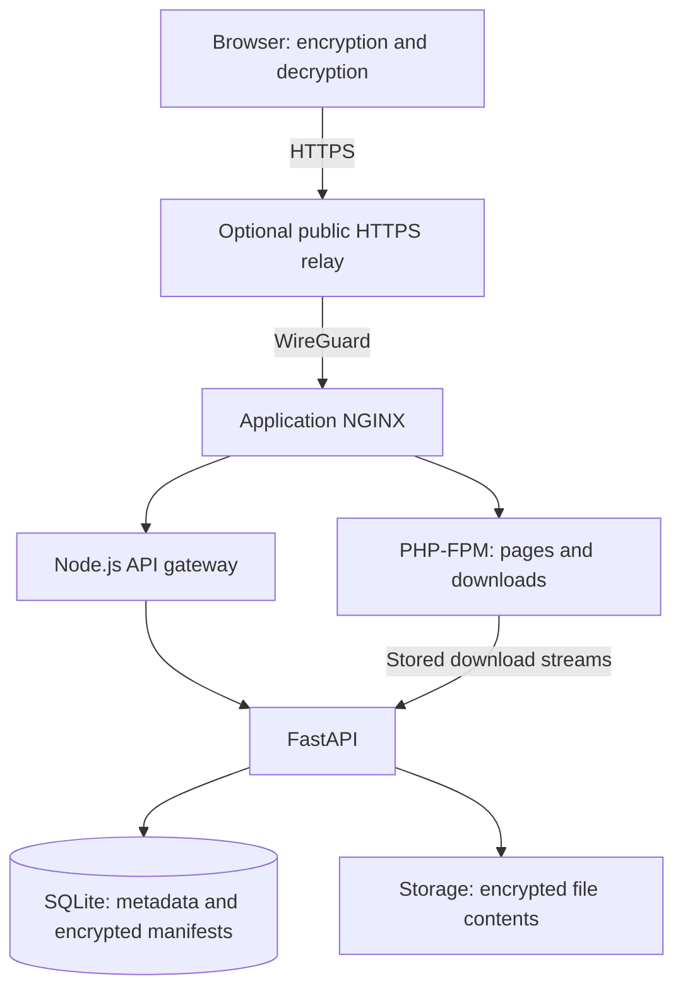

<a id="filevoya"></a>

<div align="center">

# 📂 Filevoya

### Encrypted file sharing. Your storage. Your infrastructure.

Upload files and folders, share an expiring encrypted link, and manage your transfers from one dashboard.

[](https://filevoya.site)
[](#architecture)
[](#deployment)
[](#security)


[](LICENSE)

</div>

---

## ✨ Overview

Filevoya is a self-hosted file transfer website built with PHP, TypeScript, Bootstrap, a Node.js gateway, FastAPI, and SQLite3. Uploaded content stays on storage you control.

**New browser uploads use end-to-end encryption for file contents, filenames, and folder paths.** Encryption and decryption happen in the browser using AES-256-GCM. The application stores encrypted file contents, opaque file identifiers, and an encrypted manifest containing the original names, paths, and file keys.

The frontend uses core PHP and TypeScript without Vite. Docker Compose runs four application services: `web`, `php`, `gateway`, and `api`. A separate public HTTPS reverse proxy and WireGuard relay can be added for a remote storage server.

> **Save the complete share link, including its `#key=...` fragment.** The server does not store the decryption key and cannot recreate a lost complete link from your account dashboard.

## 🚀 Features

| Feature | Description |
| --- | --- |
| 🔐 Browser encryption | Encrypt file contents, filenames, and folder paths before uploading. |
| 📤 File and folder uploads | Select files or a folder through the Upload menu, or use drag and drop. |
| 🗂️ Folder structure | Keep original relative paths inside the encrypted manifest and downloaded ZIP archives. |
| 🔗 Encrypted share links | Share the complete transfer link containing the browser decryption key. |
| 📥 Encrypted downloads | Decrypt individual files and assemble ZIP downloads in the browser through a service worker. |
| ⏳ Expiration | Transfers expire after 24 hours. |
| ♻️ Automatic cleanup | Remove expired transfers and pending uploads inactive for 15 minutes. |
| 📊 Storage allowance | Track a 5 GB allowance for regular accounts and guest browser identities. |
| 👤 Accounts | Register, sign in, sign out, and change your password through Settings. |
| 📁 Your files | View paginated account transfers, upload progress, storage usage, and expiration information. |
| 🗑️ Transfer deletion | Account owners can delete their transfers and release reserved storage. |
| 🔄 Upload retries | Resume confirmed chunk progress while the same upload page, selected files, and encryption state remain available. |
| 🛡️ Abuse controls | Apply account, client-IP, storage, pending-upload, and daily upload limits. |
| 🚩 Abuse reporting | Report a transfer without submitting its decryption key; review reports from the server terminal. |
| 🛠️ Upload administrator | Grant one existing account a privileged upload role through a server-only command. |
| 🎨 Updated interface | Use a responsive dark theme, consistent red accents, and locally served SVG icons and Bootstrap assets. |

The account dashboard can manage encrypted transfers without decrypting their names. To open or share an encrypted transfer, use its saved complete link or enter its saved key on the share page. Upload retries depend on the original page's in-memory state; reopening a saved download link does not restore an upload session.

## ⚙️ Current limits

These are the current regular-upload defaults. GB values use decimal bytes; encryption overhead counts toward upload and storage quotas.

| Setting | Default |
| --- | --- |
| Storage per regular account or guest browser identity | 5 GB |
| Maximum regular transfer size, including encryption overhead | 5 GB |
| Files per regular transfer | 25 |
| Files per administrator transfer | 200 |
| Transfer lifetime | 24 hours from creation |
| Maximum encrypted upload chunk | 8 MiB, including its 16-byte authentication tag |
| Pending regular transfers per client IP | 3, reserving at most 5 GB combined |
| Pending upload inactivity timeout | 15 minutes since creation or the last successful chunk |
| Transfer creation attempts per client IP | 10 per minute |
| Active regular-upload allowance per client IP | 10 GB |
| Upload allowance per client IP per 24-hour budget window | 20 GB and 100 transfers |
| Shared regular-upload storage pool | 100 GB |
| Minimum free disk reserve | 5 GB |
| Maximum stored transfers | 10,000 |
| Browser timeout for each upload chunk | 120 seconds |
| Abuse report attempts per client IP | 5 per hour |

Guest storage is associated with a browser cookie. Client-IP limits also apply across guest identities and regular accounts, so people sharing a public IP share those limits. Pending reservations count toward capacity before an upload finishes.

The upload administrator bypasses the regular account, transfer-size, pending-upload, and per-IP upload-budget quotas. Administrator uploads still have the 200-file limit, request validation, transfer-creation throttling, the stored-transfer count limit, and physical disk-space checks. The administrator role does not provide a decryption key for other users' transfers.

## 🧰 Technology stack

| Layer | Technology | Purpose |
| --- | --- | --- |
| Pages and download proxy | PHP; Docker image uses PHP 8.4 | Render pages and stream stored download bytes from the API. |
| Browser logic | TypeScript 5.9.3 | Handle encrypted uploads, drag and drop, account interactions, and progress. |
| Browser cryptography | Web Crypto, AES-256-GCM | Encrypt and authenticate file chunks and the manifest. |
| Download worker | Service worker and browser streams | Decrypt downloads and build encrypted-transfer ZIP archives locally. |
| Interface | Bootstrap 5.3.8 and CSS | Provide forms, menus, responsive layouts, and the dark theme. |
| API gateway | Node.js 24 and TypeScript | Validate and forward bounded browser API requests. |
| Application API | Python 3.12 and FastAPI | Manage accounts, transfer metadata, encrypted uploads, stored downloads, and cleanup. |
| Database | SQLite3 | Store account records, session hashes, ownership, encrypted manifests, progress, reports, and budgets. |
| Application web server | NGINX and PHP-FPM | Serve assets and PHP pages, and proxy `/api/` requests. |
| Containers | Docker Compose | Run `web`, `php`, `gateway`, and `api`. |
| Reference host | Debian Linux | Host the application and persistent storage. |
| Optional private relay connection | WireGuard | Protect transport between a public relay and the storage server. |

<a id="architecture"></a>

## 🏗️ Architecture

The reference deployment uses an AWS relay for public HTTPS traffic and a Debian server for the application, database, and uploaded files. The public Compose template also supports a local instance without that relay.



The relay forwards requests; the application stores uploaded files on the storage server. New encrypted transfers are decrypted by the recipient's browser. PHP and FastAPI stream stored encrypted bytes rather than decrypting those transfers. For encrypted ZIP downloads, the browser assembles the archive after decrypting the selected files. Legacy unencrypted transfers retain their existing download paths until they expire.

<a id="security"></a>

## 🔐 Security and encryption

### Browser encryption and key handling

- **File contents:** Each file receives an independently generated 256-bit AES-GCM key. File chunks use authenticated framing that binds them to their file and position.
- **Names and paths:** The manifest contains the original filenames, folder paths, sizes, and file keys. The browser encrypts it with a separately generated 256-bit key before uploading it.
- **Share links:** The manifest key is placed in the link's URL fragment, `#key=...`. URL fragments are not normally included in HTTP requests; the share page reads the key locally to decrypt the manifest.
- **Integrity checks:** The browser verifies AES-GCM authentication and validates manifest entries and expected file sizes during download. Altered or incomplete encrypted data causes decryption or verification to fail.
- **Key recovery:** The server receives the encrypted manifest, not its decryption key. Save the complete link during upload and keep it for future downloads. The dashboard cannot regenerate its key.
- **Reporting:** The reporting flow sends a transfer ID and category, without the key fragment. Reports do not automatically delete a transfer or reveal its encrypted contents.

### Accounts, storage, and transport

- Passwords are hashed with Argon2. Account session tokens are stored as hashes in SQLite.
- Account cookies use `HttpOnly` and `SameSite`; the public HTTPS configuration must enable `Secure` cookies.
- Account changes and authenticated write requests enforce origin checks. Invalid or revoked account cookies are cleared.
- Upload paths, offsets, sizes, and upload tokens are validated. Stored file access checks paths and protects against symlink traversal.
- Transfer deletion requires the authenticated owner. Privileged upload-role changes and password recovery require server access.
- Pending reservations, storage budgets, client-IP limits, and automatic cleanup help contain abandoned uploads and abuse.
- The public NGINX template overwrites caller-supplied client identity headers. Reverse-proxy deployments must separately configure trusted real-IP handling.
- HTTPS protects browser transport. WireGuard and encrypted storage such as LUKS can provide additional protection in a self-hosted deployment.

### Privacy boundaries

The server still processes encrypted sizes, file counts, transfer timing, account ownership, and connection information. A guest cookie tracks the guest browser's storage allowance; guest uploads do not guarantee anonymity. Connection information may appear in server or hosting-provider logs.

Anyone with the complete share link can decrypt its files. Browser encryption depends on trustworthy code delivered by the website and the security of the browser. Expiration or deletion stops new access through Filevoya but cannot erase copies already downloaded; downloads already in progress may finish.

HTTPS, WireGuard, and disk encryption are deployment choices. Building the containers does not automatically configure them. The public example uses local HTTP; public deployments must provide HTTPS. Existing unencrypted transfers are not converted automatically.

## 🌐 Browser requirements

Encrypted uploads require a secure browser context and Web Crypto. Encrypted downloads also require service workers and browser streaming support. Public access should use HTTPS; the exact local origin `http://127.0.0.1:8080` is supported by the development setup.

Some privacy settings block service workers or browser storage features. If encrypted-download support cannot start, check those settings and the browser's site permissions. Keep the share page open while a download is being decrypted and saved, and use the browser's downloads interface to monitor completion or cancel it.

## 📂 Project layout

The repository root contains this README, `LICENSE`, and the application directory `transfer-serv/`. Paths below are relative to `transfer-serv/`.

| Path | Contents |
| --- | --- |
| `api/app/` | FastAPI authentication, transfers, storage, encrypted metadata, downloads, reports, and cleanup. |
| `api/app/admin.py` | Server-only upload-administrator role management. |
| `api/app/reset_password.py` | Interactive password reset and account-session revocation. |
| `api/app/abuse.py` | Key-free report endpoint and terminal moderation commands. |
| `api/Dockerfile` | Python API image and Uvicorn startup. |
| `frontend/src/encryption.ts` | Browser encryption and encrypted-manifest validation. |
| `frontend/src/encrypted-download.ts` | Share-page decryption and download-worker coordination. |
| `frontend/src/` | Uploads, accounts, storage indicators, folder interactions, and reporting. |
| `frontend/worker/crypto-download.ts` | Streaming decryption and ZIP generation in the service worker. |
| `frontend/public/e2ee-worker.js` | Service-worker entry point. |
| `frontend/public/` | PHP pages and public assets. |
| `frontend/includes/` | Shared PHP page components. |
| `frontend/public/assets/icons/` | SVG sprites and third-party icon license notices. |
| `frontend/Dockerfile` | Asset build, PHP-FPM, and NGINX image stages. |
| `gateway/src/server.ts` | Node.js API gateway. |
| `gateway/Dockerfile` | Gateway image build. |
| `nginx/default.conf` | Generic application NGINX configuration. |
| `scripts/clone-bootstrap.mjs` | Copy installed Bootstrap assets into the public asset directory. |
| `scripts/dev.mjs` | Linux development launcher and service readiness checks. |
| `.env.example` | Public example configuration, without credentials. |
| `.gitignore` / `.dockerignore` | Exclude private settings, runtime data, generated assets, and common key files. |
| `compose.yaml` | Services, network, host port, environment settings, and persistent mounts. |

## 💻 Local development

### Prerequisites

- Linux for the included development launcher.
- Git, Node.js 24 or newer with npm, Python 3.12 with `pip` and venv support, and PHP CLI. The container images use PHP 8.4 and Python 3.12.
- Available local ports `8000`, `3000`, `8001`, and `8080`.
- A browser with the encryption and download features described above.

The commands below use Bash. If your terminal uses fish, enter `bash` before pasting shell blocks that use Bash syntax.

### Clone and enter the application directory

```bash
git clone https://github.com/qy0m/File-Transfer.git filevoya
cd filevoya/transfer-serv
```

The outer `filevoya` directory is the checkout name chosen by this command. The inner `transfer-serv` directory contains `package.json` and `compose.yaml`. **Run application setup, checks, administration, and Compose commands from that inner directory.** If you arrange the source differently, use the directory containing those two files.

## Required filenames before setup

This upload includes three filenames with a leading `!` as a workaround uploading hidden files.
Before installing, building, or running the project, restore their standard names inside `transfer-serv/`:

| Uploading file | Required action |
| --- | --- |
| `!.env.example` | Rename to `.env.example`. |
| `!.gitignore` | Replace the older `.gitignore` with this file's contents, then remove `!.gitignore`. |
| `!.dockerignore` | Replace the older `.dockerignore` with this file's contents, then remove `!.dockerignore`. |

Keep the `!.env.example` line **inside** `.gitignore`: it is a Git
exception rule allowing the safe example file to be tracked.
Never publish your real `.env` or private keys.

### Install and run

```bash
python3 -m venv .venv
.venv/bin/python -m pip install -r api/requirements.txt
npm ci
mkdir -p var/native/database var/native/uploads
env DATABASE_PATH=var/native/database/transfers.sqlite3 UPLOAD_PATH=var/native/uploads npm run dev
```

Open [http://127.0.0.1:8080](http://127.0.0.1:8080). The launcher builds the assets, starts FastAPI, the gateway, PHP, and a local web proxy, and checks that they are ready. Press **Ctrl+C** to stop the development services.

This example uses `var/native/` to keep native development data separate from Docker-owned storage directories. The launcher supplies the local origin and cookie settings directly; it does not automatically load the Compose `.env` file. AWS, WireGuard, and production mounts are not required for local development.

<a id="deployment"></a>

## 🐳 Docker Compose deployment

### Fresh local instance

Install Docker Engine and the Docker Compose plugin. From `transfer-serv/` in a fresh checkout:

```bash
cp .env.example .env
mkdir -p var/database var/uploads
sudo chown -R 10001:10001 var/database var/uploads
sudo chmod 750 var/database var/uploads
sudo docker compose config --quiet
sudo docker compose up -d --build --wait --wait-timeout 120
sudo docker compose ps
curl --fail-with-body --max-time 20 http://127.0.0.1:8080/api/health
```

Use your existing `.env` when one is already configured. The commands above assume the example `DATA_ROOT=./var`. The API container runs as UID 10001 and needs write access to the database and upload directories.

The public template binds one web port to loopback by default. API, gateway, and PHP-FPM ports remain unpublished. The example `.env` uses `COOKIE_SECURE=0` for local HTTP; public HTTPS requires `COOKIE_SECURE=1` and the exact public `APP_ORIGIN`.

The health endpoint should return:

```json
{
  "ok": true,
  "gateway": "node-typescript",
  "api": "fastapi",
  "database": "sqlite3"
}
```

### Configuration

Keep the real `.env` private. `.env.example` is intended to be committed so another operator can reproduce the setup.

| Variable | Example default | Purpose |
| --- | --- | --- |
| `APP_ORIGIN` | `http://127.0.0.1:8080` | Exact browser-facing origin, including scheme and any nonstandard port. |
| `COOKIE_SECURE` | `0` in `.env.example` | Local HTTP only; use `1` with public HTTPS. Compose's fallback is `1` if this setting is absent. |
| `HTTP_BIND` | `127.0.0.1` | Host interface for the single published web port. |
| `HTTP_PORT` | `8080` | Host web port. |
| `DATA_ROOT` | `./var` | Host storage root, relative to `compose.yaml` or an absolute path. |
| `DOCKER_SUBNET` | `172.30.0.0/24` | Container subnet and the API's trusted proxy network. |
| `MAX_STORAGE_BYTES` | `100000000000` | Shared regular-upload storage allowance. |
| `MIN_FREE_DISK_BYTES` | `5000000000` | Minimum free disk reserve. |
| `MAX_STORED_TRANSFERS` | `10000` | Stored-transfer count limit. |
| `MAX_ACTIVE_BYTES_PER_CLIENT` | `10000000000` | Active regular-upload allowance per client IP. |
| `MAX_DAILY_BYTES_PER_CLIENT` | `20000000000` | Upload-byte budget per client IP per 24-hour window. |
| `MAX_DAILY_TRANSFERS_PER_CLIENT` | `100` | Transfer budget per client IP per 24-hour window. |

If the example subnet overlaps another Docker, LAN, or VPN network, select an unused private subnet before starting. Compose uses `DOCKER_SUBNET` both for its network and for the API's `TRUSTED_PROXY_NETWORKS` environment setting. If you customize networks independently, update that API setting to match the actual trusted internal proxy peers.

Compose maps `${DATA_ROOT}/database` to `/data/database` and `${DATA_ROOT}/uploads` to `/data/uploads`. It sets the API's `DATABASE_PATH` to `/data/database/transfers.sqlite3` and `UPLOAD_PATH` to `/data/uploads`. Changing host storage is done through `DATA_ROOT`; adding an unrelated variable to `.env` does not automatically change those container paths.

Create storage directories with the correct permissions before startup. Bind mounts use `create_host_path: false`; missing directories cause startup to fail instead of silently creating a new storage location. Unlock and mount an encrypted data volume before starting the containers that use it.

### Public HTTPS and relay configuration

Configure your own domain, HTTPS reverse proxy, firewall, and any WireGuard connection. The supplied `nginx/default.conf` provides the application HTTP entry point; it does not install certificates or configure a public relay.

Set `APP_ORIGIN` to the public origin and enable secure cookies. Keep private hostnames, tunnel bindings, certificate paths, and deployment-specific settings in ignored local files such as `compose.override.yaml` or `compose.override.yml`.

When a reverse proxy sits in front of the application NGINX instance, configure real-IP handling with only that proxy's trusted addresses and its authoritative client-IP header. The generic template uses the immediate peer address until that configuration is supplied. Do not accept arbitrary forwarding headers as proof of client identity.

**Existing installations:** The public Compose template removes the site-specific tunnel binding and makes storage paths and the container network configurable. Preserve your private deployment settings and migrate intentionally before restarting a live service. Review `frontend/public/about.php` so its descriptions of HTTPS, WireGuard, and encrypted disks match your actual deployment.

### Checks, logs, and updates

```bash
sudo docker compose exec api pip check
sudo docker compose exec web nginx -t
sudo docker compose logs --no-color --tail=100 api gateway php web
```

After updating the source and reviewing your local configuration:

```bash
sudo docker compose config --quiet
sudo docker compose up -d --build --wait --wait-timeout 120
sudo docker compose ps
```

Rebuilding all services ensures PHP pages, gateway code, browser code, and the download worker are updated together.

## 🛠️ Server administration

Run these commands from the application directory on the server. Replace `YOUR_USERNAME`, `TRANSFER_ID`, and `REPORT_ID` with the relevant existing values.

### Upload administrator

Register an account through the website first. No administrator account or default production password is bundled. Run only the action you need: inspect, grant, or revoke.

```bash
sudo docker compose exec api python -m app.admin YOUR_USERNAME --status
sudo docker compose exec api python -m app.admin YOUR_USERNAME --grant
sudo docker compose exec api python -m app.admin YOUR_USERNAME --revoke
```

Only one upload administrator may exist. Revoke the current administrator before granting the role to another account. Changing the role revokes that account's current sessions, so sign in again afterward.

### Password recovery

```bash
sudo docker compose exec api python -m app.reset_password YOUR_USERNAME
```

The command prompts interactively for a new password and confirmation, then revokes the account's existing sessions. It does not recover encryption keys or lost share links.

### Abuse reports and moderation

```bash
sudo docker compose exec api python -m app.abuse list
sudo docker compose exec api python -m app.abuse disable TRANSFER_ID
sudo docker compose exec api python -m app.abuse resolve REPORT_ID
```

`list` shows recent open reports. `disable` expires a transfer, revokes its upload session, and leaves its stored files for automatic cleanup. `resolve` closes an individual report without disabling its transfer. Reports alone do not trigger removal. These commands do not decrypt file contents; already-started downloads may finish.

## 🧪 Development and functional checks

With native project dependencies installed, run from `transfer-serv/`:

```bash
npm run check
npm run build
.venv/bin/python -m pip check
.venv/bin/python -m compileall -q api/app
find frontend -type f -name '*.php' -exec php -l {} \;
```

The build compiles frontend, service-worker, and gateway TypeScript and copies Bootstrap assets. Generated JavaScript goes to `frontend/public/assets/js/`; gateway output goes to `gateway/dist/`. Generated JavaScript, vendor assets, dependencies, and runtime data are excluded from the publication source and rebuilt as needed. Docker builds also check Python syntax and lint PHP.

**API compatibility:** Creating a new transfer now requires the versioned encryption metadata and opaque file records generated by the browser encryption flow. The former plain filename-and-size `POST /api/transfers` example returns HTTP 422 because encryption metadata is missing. Use `/api/health` for a basic service check and the browser for an encrypted upload check.

After installing the API requirements and running `npm ci` and
`npm run build`, run the encrypted storage checks on Linux from
the `transfer-serv/` directory:

    .venv/bin/python scripts/test-storage-limits.py

The test requires Node.js 24 or newer. It generates encrypted requests
using the built frontend encryption module and starts private API
processes with temporary databases and upload directories.

It checks storage reservations, transfer counts, owner deletion,
shared-IP limits across cookies and accounts, and daily allocations
retained after deletion. It does not target your running deployment.

- [ ] The health endpoint responds successfully through the intended web origin.
- [ ] Registration, login, logout, password changes, and session recovery work.
- [ ] Guest and regular-account storage allowances and client-IP budgets are enforced.
- [ ] File selection, folder selection, and drag and drop work.
- [ ] New uploads store opaque filenames and encrypted manifest data.
- [ ] A complete saved share link decrypts files in a second supported browser.
- [ ] A missing or incorrect key fails to unlock the transfer.
- [ ] Downloaded files match the original bytes and filenames.
- [ ] Encrypted ZIP downloads preserve the original folder paths.
- [ ] Interrupted uploads can resume while the original page remains open.
- [ ] Encrypted dashboard entries do not expose names or claim to recover lost keys.
- [ ] Deletion releases storage and prevents new downloads through the share link.
- [ ] Expired transfers and inactive pending uploads are cleaned up.
- [ ] Changing a guest cookie does not bypass client-IP limits.
- [ ] Reports submit without a decryption key and can be reviewed through the terminal.
- [ ] Administrator role changes require server access and remain limited to one account.
- [ ] The service starts correctly after its required storage and network interfaces are available.

## 💾 Storage and backups

The public template uses `${DATA_ROOT}/database/` and `${DATA_ROOT}/uploads/` on the host. Choose your own persistent storage location; backups should be stored separately from the live data they protect.

Back up an active SQLite database through SQLite's backup API or another method that accounts for its write-ahead log. Copying only the main database file during active writes can miss committed data. Protect configuration backups, keep an off-device recovery copy, and retain a protected LUKS header backup when using LUKS storage.

Database and configuration backups do not automatically include uploaded file contents. Include those separately if your recovery plan needs to restore active transfers. Server backups do not recreate missing browser decryption keys; retain complete share links separately if future access is required.

## 🤝 Contributing and publishing

Describe substantial proposed changes in an issue, keep changes focused, and include relevant checks and reproduction steps.

Never commit real `.env` files, SSH or WireGuard private keys, TLS private keys, account databases, uploaded content, logs, recovery material, or backup archives. `.env.example` contains public example values and should remain tracked. Keep private deployment overrides separate from the public Compose template.

Ignore rules help prevent accidental additions, but they do not remove already-tracked files or secrets from earlier commits. Review `git status` and the staged diff before publishing. If publishing through a ZIP, inspect and upload the extracted source files, including the intended dotfiles; keep ZIP backups outside the repository.

## 📜 License

The project is licensed under the [Apache License 2.0](LICENSE). Retain the repository's license and the separate third-party icon license notices in `transfer-serv/frontend/public/assets/icons/`.

---

<div align="center">

**Filevoya — encrypted file sharing on infrastructure you control.**

[Visit Filevoya](https://filevoya.site) · [Source code](https://github.com/qy0m/File-Transfer) · [Back to top](#filevoya)

</div>
